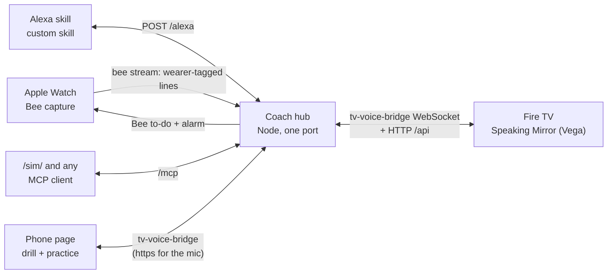

# Speaking Mirror: a realtime speaking coach on Bee

Bee hears you say "I guess" four times in two minutes, and about 20 seconds later your wrist buzzes. When the conversation ends you get a recap. When you practise, you re-say the line to Alexa or your phone, and the attempt is graded from **Bee's own wearer-tagged transcript**, not from the mic you said it into. The Fire TV "Speaking Mirror" shows your week, the live pipeline and the before/after check.

- **Bee is the input of record.** Habits come from Bee captures, live nudges from `bee stream`, and every drill grade from the line Bee tags as you. Phone and Alexa text is only a provisional preview; if they disagree, Bee wins.
- **AI finds the habits; deterministic code grades and decides.** Unsure words ("I guess", "maybe", "kind of") and the filler "like" are the hero habits: the two you practise, pre-registered in `prereg/transfer.json` (keys `hedges` and `filler:like`). Vague answers and the other filler words ("um", "uh", "you know") are tracked too, and starting over ("the the", key `restart`) is the one you deliberately don't practise, kept for comparison.
- **Four surfaces, one hub:** the Apple Watch (Bee capture plus to-do alarms as wrist nudges), Alexa (a custom skill and an MCP server, with a browser simulator), Fire TV (a Vega app) and a phone page (drills and practice meters).

## Start here (no accounts, no keys, about 2 minutes)

```bash
npm run setup          # installs the hub and the web TV
npm run demo           # builds the pages and starts the hub with SYNTHETIC data and a Bee event replay
```

Then open:

- **TV:** http://localhost:8791/tv/ (arrow keys and Enter move along the tabs);
- **Alexa+ simulator:** http://localhost:8791/sim/ (a real MCP client: type or say "quiz me", repeat the sentence, then "how did I do?");
- **Phone:** scan the TV's QR from a phone on the same Wi-Fi. Over plain `http://` on the LAN the phone can type a drill attempt, but browsers allow the microphone (voice drills and practice meters) only on https: run `ngrok http 8791` and start the hub with `PUBLIC_BASE_URL=https://<your-ngrok-host>`, so the QR carries the https link ([`docs/tv.md`](docs/tv.md), "Mic check").

`npm run demo:replay` prints the whole live story with its latency hops, with no Bee, Watch or AWS. The Fire TV app has its own install: `npm install --prefix tv/vega && npm run tv:vega:build`, then it runs on the Vega Virtual Device (`docs/tv.md`).

Everything the demo shows is labelled **SYNTHETIC DEMO DATA** on screen. With a Bee account, `npm run hub` runs the same surfaces on your real data.

## What we'll tell you before you find it

- **Demo mode replays Bee.** `npm run demo` replays recorded-shape Bee events; the "verified by Bee" step there is the replay, and the screens say so.
- **Latency is set by Bee.** A tagged line reaches the hub about 5.4 s (median; range 4.3 to 14.7 s) after you stop speaking, measured on our Watch. A wrist nudge therefore lands about 17 to 20 s after the line that triggered it, and a voice drill takes two turns, because an Alexa reply must come within 8 s.
- **The Watch buzzes only while Bee is recording and the iPhone is locked.** Otherwise the alarm shows on the iPhone (iOS notification mirroring).
- **The before/after check is pre-registered but young.** `prereg/transfer.json` fixed the practised habits (unsure words and filler "like") and the one you don't practise (starting over) before the first practice. `GET /api/transfer` reports `not drilled yet`, `too little data` or `no change` until real speech after practice shows a drop, and it says so when the one you didn't practise dropped too.
- **Alexa+ third-party add-ons are partner-gated**, so the Alexa surface is a classic custom skill (tested in the Alexa iPhone app) plus an MCP server any MCP client can use; `/sim/` is that client in a browser, with a keyword router standing in for Alexa+'s model.
- **No audio is stored by Bee**, so tone and pitch exist only in phone practice mode; Bee-based coaching works from words and timing.

- **Bee vs meeting captions.** On one meeting both heard, unsure words came out alike (11 against 11) and filler "like" nearly alike, while captions showed fewer "um" and "uh" (4.7 against 6.7 per 100; the 95% intervals overlap, so one meeting does not show a real gap). See `docs/instrument-check.md`, `npm run instrument:check` and `GET /api/instrument`. Progress shows a secondary "Including meeting captions" line under the Bee-only result, labelled as not the pre-registered check. A meeting that Bee also heard counts once there: from Bee when Bee heard most of it, else from the captions with Bee's lines inside the meeting left out.

## How it fits together



- **Bee (Watch + `bee` CLI)** is the input of record: `bee stream` delivers wearer-tagged lines for habits, live nudges and every drill grade, and Bee to-dos with alarms are the wrist nudges.
- **The hub** holds all state. It verifies each attempt against Bee (`src/hub/bee.ts`), grades it deterministically (`src/hub/grade.ts`), runs the live coach and recaps (`src/hub/live/`), and serves every surface from one port behind a public-access gate (`src/hub/gate.ts`).
- **Alexa** runs drills by voice in two turns ("checking with Bee", then "how did I do?"); **MCP** exposes the same drill and stats tools to any assistant, and `/sim/` is a browser MCP client.
- **Fire TV** shows the week, the live drill pipeline and the before/after check. It gets the hub's events through `tv-voice-bridge` (a WebSocket pairing and relay library of ours, vendored as a tarball in `vendor/`; its README and protocol ship inside it, at `node_modules/tv-voice-bridge/README.md` and `PROTOCOL.md` after `npm run setup`), and reads the week, the transfer check, the live state and recaps over HTTP (`/api/stats`, `/api/transfer`, `/api/live`, `/api/recaps`).
- **The phone page** is the practice microphone (volume, pitch, pace) and a typed or spoken drill input, also over the bridge. Its microphone needs https (the `ngrok http` link above); over LAN `http://` it is typing only.

## Coach hub (shared core for the TV mirror and the Alexa drill session)

The hub is the single state behind every surface: a Fire TV "speaking mirror" (habit rates, the before-and-after check of the habits you practise against the one you don't, live sync) and Alexa+ practice (next line, re-say it, graded by Bee, schedule updated). Its contract, with example payloads for every endpoint and event, is [`docs/CONTRACT.md`](docs/CONTRACT.md).

```bash
npm run hub                     # live: real gitignored data, spawned `bee stream`, Bee CLI fallback poll (port 8791)
npm run hub -- --demo           # demo: SYNTHETIC fixtures + Bee event REPLAY (no Watch, no network), labelled as such
npm run contract:check          # starts the demo hub; TV + phone over the bridge + SSE; asserts the event sequences
npm run hub:cards               # adds deterministic hedge / "like" cards from your own Bee lines to real/deck.json
npm run demo:fixtures           # regenerates fixtures/demo/ (deterministic)
```

- **Bee is the input of record.**
  - Habits, drills and stats come from Bee captures. Meeting captions are a secondary source, used only with `source=all` and always labelled.
  - In a drill, a phone or Alexa transcript is a provisional preview. The attempt counts when Bee's live stream tags the wearer saying it, and then Bee's text is graded. If the preview and Bee disagree, Bee wins.
  - With no tag on the stream within 30 s, the hub polls the conversation through the Bee CLI. With nothing by 45 s, the attempt is "unverified" and does not count.
  - A voice drill takes two turns, because Bee's line takes 5 to 20 s and a voice skill must answer within 8 s. `POST /api/attempt` returns `pending_bee` at once, and `GET /api/attempts/<id>` returns Bee's verdict once it lands. A Bee line merged with the next words ("... How did I do?") is matched by coverage, and the extra sentence is cut before grading.
- **AI finds the habits; code grades the attempt.** `src/hub/grade.ts` is deterministic and gives a reason for every rule:
  - the target habit occurs 0 times;
  - 0 fillers;
  - at least 80% of the target sentence is matched, with fuzzy word matching for ASR slips ("car" for "card", "rec board" for "rack board");
  - every concrete word the fix introduces is said.
- **Hero habits.** Unsure words ("I guess", "maybe", "kind of") and the filler "like": the two practised habits, pre-registered in `prereg/transfer.json`. Vague answers ("that thing", "getting there", "and stuff") and the other filler words are tracked, and starting over ("the the") is the one you don't practise, kept for comparison (the control).
- **Is it working?** `GET /api/transfer` asks whether a practised habit dropped in later real speech (practice lines excluded), compared with the habit you deliberately didn't practise. It reports rates per 100 words with 95% intervals, before vs after your first practice, and a plain verdict.
  - Both are pre-registered in `prereg/transfer.json` (written 2026-10-16, before any practice).
  - The endpoint refuses to report an unregistered habit as practised.
- **Like with like.** Each conversation is tagged Meeting, Work talk or Casual (deterministic rules on times, calendar events and speaker counts; one press on the TV corrects it), and recaps compare with your usual in that setting. `GET /api/settings` is a secondary view; the pre-registered check above never uses it ([`docs/live.md`](docs/live.md), "Settings").
- **Finished conversations are picked up automatically.** Once Bee marks a conversation complete, the running hub fetches it, keeps the wearer's lines through the same wearer filter and mislabel rules as `npm run real`, and refreshes the stats and the first signal. No rerun or restart is needed ([`docs/live.md`](docs/live.md)).
- **Privacy.** Stream text stays in memory until Bee tags it as the wearer. Untagged and other-speaker lines are never sent to a surface or written to disk.
- **Filming: list names to hide in `coach/mask-terms.local.txt`** (gitignored, one per line), then restart the hub. Screens show `▒▒▒` and Alexa and MCP say "name" for each one, and for every term in `coach/private-terms.local.txt`; grading and the saved files keep the real words. Health shows only `masking: on (N terms)` ([`docs/live.md`](docs/live.md), "Filming").
- **Phone microphone.** It uses `tv-voice-bridge`, vendored as `vendor/tv-voice-bridge-0.3.5.tgz`.

## Privacy design

Real transcripts contain other people's speech (classmates, friends, assistants).

- **Wearer-only persistence.** `loadRealCorpus` returns the wearer's lines (the only thing ever written to disk) and, separately, an in-memory `TransientContext` of other speakers' lines. That context is never serialized; it exists only so an LLM prompt can see the reply to a "how do you say X?" moment, and the prompt tells the model not to quote it. Error extraction prompts contain wearer lines only. `test/real.test.ts` enforces this: a planted other-speaker string must not appear in the corpus, the analysis or the class report.
- **Gitignored outputs only.** Real data goes to `real/`, `out/`, `cache/`, `fixtures/private/` and `day1/*.json`, all gitignored. Tracked reports carry aggregates plus at most 10 short (≤ 12 words) excerpts of the wearer's own lines.
- **Leak check.** `scripts/leak-check.ts` searches every committable file, of any size, for 5-word shingles of other speakers' live utterances (held in memory), their whole 3-4 word lines, location address tokens and JWT-shaped tokens. JSON escapes are undone first. It also screens:
  - optional `bee stream` captures (`--stream`): untagged lines count as other speakers;
  - optional meeting transcripts (`--wearer "<name>" --tactiq <file>`).

  Only lines a source labels as the wearer count as the wearer's; the hub's own state (`real/hub-attempts.json`, `real/live/`) is screened for other-speaker text, never used as an allow-list. A committable audio file fails the check, and so does a committable image until a person has looked at it and recorded it with `--approve-images` (`leak-check-images.txt`, pinned by sha256; screenshots can show drill or live text). A hit in a file dated before the recording is "predates", not a leak; the date comes from git, not the mtime (a copy can keep an old mtime), and files written before the repo existed are vouched for once with `--approve-predates` (`leak-check-predates.txt`). The coach speaks its prompts aloud, and Bee can label that voice as another speaker: a tracked file whose other-speaker hits are all inside the product's own string literals is vouched for with `--approve-product-voice` (`leak-check-product-voice.txt`: the file's sha256 and a hash of each matched phrase, never the text; any edit flags it again). It also fails if any private output path (`real/`, `out/`, `cache/`, the hub's state files) is not git-ignored.
- The bee token is never read, printed or stored by this code; the CLI handles auth.

## Layout

- `src/hub/`: the coach hub.
  - The grader (`grade.ts`, `fuzzy.ts`) and habits (`habits.ts`).
  - Cards and the scheduler (`cards.ts`, `scheduler.ts`, `realCards.ts`).
  - Bee stream parsing and attempt verification (`bee.ts`).
  - Stats and transfer (`stats.ts`) and the brief (`brief.ts`).
  - State (`core.ts`), crash-safe state files (`atomic.ts`), the live and demo wiring (`setup.ts`, `demoData.ts`).
  - The server (`server.ts`), the public-access gate (`gate.ts`) and static pages (`static.ts`).
  - `live/`: the realtime coach (`window.ts`, `rules.ts`, `policy.ts`, `wrist.ts`, `recap.ts`, `engine.ts`).
- `src/alexa/` and `alexa/`: the Alexa skill handler and its skill package. `src/mcp/`: the MCP server and its loopback hub client.
- `tv/web/` and `tv/vega/`: the Speaking Mirror TV app for the browser and for Vega OS (`scripts/tv-sync.ts` keeps the shared views identical).
- `web/phone/`: the phone page. `web/sim/`: the Alexa+ simulator (a browser MCP client).
- `docs/`: `CONTRACT.md` (the hub contract), `tv.md`, `alexa.md`, `live.md`, and [`poc.md`](docs/poc.md) (the proof of concept this grew from).
- `fixtures/demo/`: synthetic demo fixtures. `prereg/transfer.json`: the transfer pre-registration. `coach/principles.template.md`: the generic coaching principles.
- `scripts/`: the hub tools (`contract-check.ts`, `demo-replay.ts`, `hub-cards.ts`, `wrist-probe.ts`, `alexa-deploy.ts`, `tv-sync.ts`, `leak-check.ts`) and the PoC tools (see `docs/poc.md`).
- `src/bee/`, `src/analyze/`, `src/coach/`, `src/sim/`, `src/eval/`, `src/report/`, `src/real/`: the proof-of-concept pipeline (see `docs/poc.md`).

## History: the drill-coach proof of concept

Speaking Mirror started as a go/no-go proof of concept: find the wearer's real recurring speech errors in Bee data, turn them into drill cards, and check re-performance against a pre-registered undrilled control. Its real-data results are in `REAL_DATA_REPORT.md`, the meetings benchmark in `MEETINGS_REPORT.md`, and how to run it in [`docs/poc.md`](docs/poc.md). **All Bee data committed to this repository is SYNTHETIC**: the fixtures were authored by a simulator (`src/sim/`) or by hand, in the exact JSON shapes of the Bee CLI.

## Private data

`fixtures/private/` (gitignored) may hold the operator's real, confidential transcripts. They are used only for the real-speech check (T6). Their text is written only to `out/` and `cache/`, which are also gitignored. It never goes into the report, the fixtures, or this README.

## License

MIT. See `LICENSE`.
