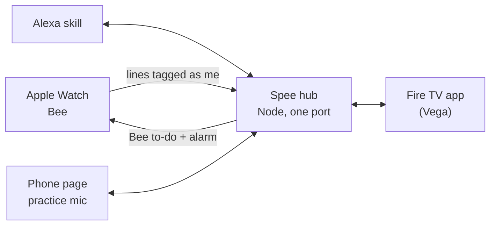

# Spee: a speaking coach on Bee

Watch the 3-minute demo: [youtu.be/CN0ZML0aY7w](https://youtu.be/CN0ZML0aY7w)

English is my second language, and my work language. Videos, courses and workshops help, but what helps most is feedback while I speak, and I never had it. In my real stand-up on October 19, about one word in ten was a filler, and Bee counted 11 unsure words, such as "I think" (`docs/instrument-check.md`). Nobody had told me.

**Spee is a speaking coach that stays on my wrist through the workday. It hears me through Bee on my Apple Watch, tells me what to change, and builds my practice from my own lines, checked against how I usually speak.**

> Bee listens. Spee tells me what to change. I do the talking.

The explainer page, with a stand-up you can step through: https://spee.live

## What it does

- **Learns how I usually speak.** From the lines Bee tags as mine, Spee counts unsure words ("I guess", "maybe", "kind of"), fillers ("like", "um", "you know"), vague answers ("that thing") and starting over ("the the"), and tracks my pace and long turns. Each count is compared with my usual in that setting: a meeting, work talk or a casual chat.
- **Tells me once, on my wrist.** With live coaching on, a streak of unsure words or "like" sends one short cue to my Watch. Then it stays quiet for a while.
- **Recaps each conversation.** What ran above my usual, my pace, and one of my own lines said plainly.
- **Lets me practise with Alexa.** Alexa gives me one of my own fumbled lines to say again. The grade comes from what Bee heard, not from Alexa.
- **Keeps score on Fire TV.** My week per habit, each drill as it moves from "You said it" to "Checked by Bee" to the result, and the before/after check.

## What makes it different

Spee is with me through the workday, not in a lesson: while Bee records, it hears my real meetings, work talk and casual chats, and with live coaching on it can nudge my wrist mid-conversation. My practice plan comes from my own data: the drills are lines I actually said, they come back on a spaced schedule (sooner when I fumble one or the habit shows up again), and every rate is checked against my own usual for that setting. Spee only coaches me: it keeps a line's text only when Bee tags it as mine, and other voices, and lines Bee doesn't tag, are only word counts; on 2026-10-16, Bee's live tag named me on 8 of 9 lines (FL-8 in `FRICTION_LOG.md`). The wrist cue isn't on a timer: it comes when I hit a streak against my own usual, at least twice my usual rate and never fewer than 3 unsure words or 4 "like"s inside 2 minutes. That streak gets one cue, then at least 3 minutes before any other nudge and 10 before the same one again.

e 2 minutes. That streak gets one cue, then at least 3 minutes before any other nudge and 10 before the same one again.

## How it works



1. **Bee hears me.** `bee stream` sends the hub each line as Bee transcribes it, and Bee tags which lines are mine. Other voices are only counted, never stored. Bee's live tag named the wearer on 8 of 9 lines when we measured it on 2026-10-16 (FL-8 in `FRICTION_LOG.md`).
2. **Plain code decides.** Fixed word lists and Bee's timing measure the habits. `src/hub/grade.ts` grades every drill and names the rule behind each verdict. A model (Claude on Amazon Bedrock) only drafts practice lines for vague answers and, if I turn it on, rewords a recap.
3. **Bee carries the cue back.** A nudge is a Bee to-do with an alarm, so it buzzes my wrist. Live nudges are off until I ask for them, and capped: 3 minutes between any two, 6 an hour, none at night.
4. **Alexa is the coach I ask.** "Quiz me" starts a drill, and "how did I do?" gives Bee's verdict. "How am I doing?" sums up my current conversation or last recap, "turn on live coaching" switches on the nudges, and "did it transfer?" reads the before/after check. On Alexa, say "Alexa, ask Speech Coach to quiz me". `npm run alexa:deploy` also sets up "Spee Coach" and "Spee" as extra development skills, not yet tried on a device ([`docs/alexa.md`](docs/alexa.md)). The same tools are an MCP server, and `/sim/` is a browser client for it.
5. **Fire TV and the phone.** The Fire TV app (React Native for Vega) shows the week, live drills and the check. The phone page is the practice microphone for pace, volume and pitch. Both connect through `vega-voice-bridge`, a pairing and relay library of mine, vendored in `vendor/` ([see it on a Fire TV Stick](https://youtu.be/D6p50MpE-wE)).
6. **An Agent Skill.** `skills/speaking-coach/SKILL.md` lets an agent warm me up before a meeting and send one if-then cue to my wrist 8 to 12 minutes before it, through the same capped queue.

The full architecture, the hub's API and the privacy design are in [`docs/how-it-works.md`](docs/how-it-works.md).

## Is it working? The before/after check

Before my first practice, on 2026-10-16, I wrote down which habits I would practise and which one I would leave alone, in `prereg/transfer.json`: unsure words (`hedges`) and the filler "like" (`filler:like`) against starting over (`restart`). `GET /api/transfer` compares my real speech before and after the first practice, per 100 words with 95% intervals. It says `too little data` until each side has 400 words, and it is allowed to say `no change`.

It is a two-tier pilot, not proof of cause: two practised habits against one control is one tier short of the formal standard for this design.

## What I'll tell you before you find it

- **The wrist cue is not instant.** Bee tags a line about 5 s after you stop speaking (median 5.4 s, 4.3 to 14.7 s, measured on 2026-10-16), so a wrist nudge lands about 20 s after the line that triggered it. In the two nudges I filmed on 2026-10-22 it took about 30 s (`FACTS.md`, "Wrist nudges").
- **Bee words the cue its own way.** Spee sends a fixed line of at most 60 characters. On my Watch, Bee showed the same cue in its own, friendlier words.
- **Drills take two turns.** A drill line can take up to about 20 s, because Bee may merge it with your next words, and Alexa must answer within 8 s, so the verdict comes on the next turn.
- **The Watch buzzes only while Bee is recording and the iPhone is locked.** Otherwise the alarm shows on the iPhone.
- **The overrule in my film is the simulator.** When Alexa hears a pass but Bee hears "um", Bee wins. The film shows that case in `/sim/` on synthetic data, labelled. My real tries on the Fire TV Stick both passed.
- **Alexa+ add-ons are partner-gated**, so the Alexa side is a classic custom skill (tested in the Alexa iPhone app) plus the MCP server.
- **Bee stores no audio**, so tone and pitch exist only in phone practice. Bee-based coaching works from words and timing.
- **Wearable feedback on unwanted words is not new.** A 2025 study (WSCoach, arXiv 2507.04238) found that near-real-time feedback and after-the-fact review both reduced unwanted words. What Spee adds: Bee as the grader, drills from my own lines, and a pre-registered check against a habit I don't practise.
- **Demo mode replays Bee.** `npm run demo` runs on synthetic data, and every screen says SYNTHETIC DEMO DATA.
- **Every number here is in `FACTS.md`.** `test/claims.test.ts` fails the test run when a doc drifts from it or from the code.

## Try it (no accounts, no keys, about 2 minutes)

Needs Node 22.12 or later.

```bash
npm run setup     # installs the hub and the web TV
npm run demo      # builds the pages, starts the hub on synthetic data with a Bee event replay
```

Then open:

- **TV:** http://localhost:8791/tv/ (arrow keys and Enter move along the tabs)
- **Alexa simulator:** http://localhost:8791/sim/ (type or say "quiz me", repeat the line, then "how did I do?")
- **Phone:** scan the TV's QR from a phone on the same Wi-Fi. The microphone needs https: run `ngrok http 8791` and start the hub with `PUBLIC_BASE_URL=https://<your-ngrok-host>` ([`docs/tv.md`](docs/tv.md), "Mic check"). Over plain http the phone can still type a drill.

`npm run demo:replay` prints the whole live story with its timings, with no Bee, Watch or AWS. The Fire TV app builds with `npm install --prefix tv/vega && npm run tv:vega:build` and runs on the Vega Virtual Device (`docs/tv.md`). With a Bee account, `npm run hub` runs the same surfaces on your real data.

Tests: `npm test` and `npm run typecheck`. The hub's API is in [`docs/CONTRACT.md`](docs/CONTRACT.md), the live coach in [`docs/live.md`](docs/live.md).

## Privacy, in short

Real transcripts contain other people's speech. Only lines Bee tags as mine are written to disk, real data goes only to gitignored folders, and `scripts/leak-check.ts` checks every committable file for other speakers' words. All Bee data in this repository is synthetic. Details: [`docs/how-it-works.md`](docs/how-it-works.md), "Privacy design".

## Built with

Bee on Apple Watch and the Bee CLI · Alexa Skills Kit and APL · Fire TV on Vega OS (React Native for Vega) · Amazon Bedrock (Claude) · Model Context Protocol · Node.js and TypeScript · React · Vitest · `vega-voice-bridge`.

## Where this is going

I want Spee to become a professional communication coach that lives on your wrist. Today it hears how I speak in real conversations, tells me one thing at the right moment, and checks later whether the practice stuck. The next steps are small:

- **Coach structure, not only words:** getting to the point first, and shorter monologues.
- **Less setup:** today the hub runs on my laptop next to Bee. A coach on the wrist shouldn't need one.
- **A stronger check:** a third pre-registered habit, started at a different time, so the before/after check meets the full design.
- **More of Bee:** Bee's daily summaries as recap context, and Bee's change feed instead of polling.
- **Real users:** people who, like me, speak English at work as a second language, and the programs that already teach them.

## License

MIT. See `LICENSE`.
